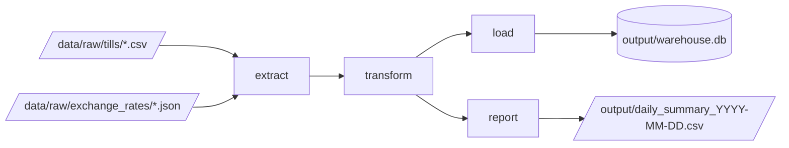

# Kettle & Crumb: the inherited sales pipeline

> **Completed working copy:** the coding exercises and stretch tasks are implemented.
> Tests now pass; the baseline failures described below refer to the original starter.
> See [COMPLETION.md](COMPLETION.md) for results, exercise answers and the remaining
> Claude-specific interactive demonstrations.

> An exercise repo for learning to work with an AI coding agent (Claude Code) as a data engineer.

## The story

**Kettle & Crumb** is a small café chain with branches in **Leeds, Manchester, York and Dublin**.

Every night a Python job collects each branch's till export, cleans it up, loads it into a
SQLite warehouse and writes a daily summary for the operations manager:



The pipeline was written by **Andy**, a contractor who has now left. It runs. Nobody quite
trusts the numbers. There are no real tests. All the documentation there is is Andy's
[handover note](HANDOVER.md).

**You are the data engineer who has just inherited it.** Your job is to understand the
pipeline, make it trustworthy and extend it. You'll have an AI agent as a pair programmer, but **you are accountable for
every line it writes**. If it's in your commit, it's your code.

Open tickets from the business are in [TICKETS.md](TICKETS.md).

## Exercises

| #   | Exercise                                                                | Session   |
| --- | ----------------------------------------------------------------------- | --------- |
| 01  | [Meet the codebase](exercises/01-meet-the-codebase.md)                  | Morning   |
| 02  | [First changes](exercises/02-first-changes.md)                          | Morning   |
| 03  | [Agentic TDD: characterise, fix, extend](exercises/03-agentic-tdd.md)   | Afternoon |
| 04  | [Context and guards](exercises/04-context-and-guards.md)                | Afternoon |
| 05  | [Stretch: spec-driven development](exercises/05-stretch-spec-driven.md) | Extension |

---

## Setup

You need **git**, **uv** and **Claude Code**.

### Claude Code

The instructions to install Claude Code are [here](https://code.claude.com/docs/en/quickstart).

If you have been given an API key, set it before launching Claude Code by running:

macOS/Linux:

```bash
export ANTHROPIC_API_KEY='your-api-key-here'
```

Windows CMD:

```cmd
set ANTHROPIC_API_KEY=your-api-key-here
```

Windows Powershell:

```pwsh
$env:ANTHROPIC_API_KEY="your-api-key-here"
```

### uv

<details>
<summary><strong>What is uv, and why are we using it?</strong></summary>

So far you've probably run Python files directly and installed packages with `pip install`
into whatever Python was on your machine. That works until you have two projects that need
different versions of the same library, or a colleague can't run your code because they have
a different setup.

A **package manager** fixes this. **[uv](https://docs.astral.sh/uv/)** is a fast, modern one
for Python. For this project it will:

- **install the right version of Python** (the one named in `.python-version`)
- **create a virtual environment** in a `.venv/` folder. This is a private copy of Python just
  for this project, so nothing you install here affects anything else on your machine.
- **install the project's dependencies** (here, `pytest` and `ruff`). These are listed in
  `pyproject.toml`, and the exact versions are pinned in `uv.lock`, so everyone gets the
  same setup.
- **run commands inside that environment** with `uv run ...`.

| File              | What it is                                          | Edit it?                                                                     |
| ----------------- | --------------------------------------------------- | ---------------------------------------------------------------------------- |
| `pyproject.toml`  | Project settings and the list of dependencies       | Yes, but prefer `uv add`                                                     |
| `uv.lock`         | Exact versions of every dependency, generated by uv | No, uv manages it. Do commit it.                                             |
| `.python-version` | Which Python version this project uses              | Rarely                                                                       |
| `.venv/`          | The virtual environment, created by uv              | No, and it's git-ignored. You can delete it, and `uv sync` will recreate it. |

</details>

#### 1. Install uv

First, check whether you already have it:

```
uv --version
```

If you see something like `uv 0.x.y`, uv is already installed. **Skip to
[step 2](#2-clone-the-repo-and-install-everything).**

If you get "command not found" / "not recognized", install it:

**Windows (PowerShell):**

```powershell
powershell -ExecutionPolicy ByPass -c "irm https://astral.sh/uv/install.ps1 | iex"
```

**macOS / Linux:**

```bash
curl -LsSf https://astral.sh/uv/install.sh | sh
```

> [!IMPORTANT]
> **Close and reopen your terminal** after installing, so it can find the new `uv` command.

Then check it worked:

```
uv --version
```

You should see something like `uv 0.x.y`. If you get "command not found" / "not recognized",
see [Troubleshooting](#troubleshooting).

### 2. Clone the repo and install everything

```
git clone <this repo's URL>
cd <repo folder>
uv sync
```

<details>
<summary>What does <code>uv sync</code> do?</summary>

`uv sync` reads `pyproject.toml` and `uv.lock`, downloads Python if needed, creates `.venv/`
and installs the dependencies. The first run takes a few seconds, and after that it's almost
instant. Run it again whenever `pyproject.toml` or `uv.lock` changes (e.g. after a `git pull`).

</details>

#### 3. Check it works

```
uv run pytest
```

You should see **1 passed** and **lots of failures**. That's expected, because the failing
tests are for exercise 02.

Then run the pipeline for one day:

```
uv run python -m kettle 2026-09-14
```

and look at `output/daily_summary_2026-09-14.csv`.

### Using uv

**The golden rule: put `uv run` in front of anything Python**, e.g. `uv run pytest`,
`uv run python some_file.py`. Don't use `pip install` in this repo.

<details>
<summary>Everyday uv commands, and why the golden rule matters</summary>

| You want to...                       | Run                                  | Instead of               |
| ------------------------------------ | ------------------------------------ | ------------------------ |
| Run the tests                        | `uv run pytest`                      | `pytest`                 |
| Run the pipeline                     | `uv run python -m kettle 2026-09-14` | `python -m kettle ...`   |
| Run any Python file                  | `uv run python some_file.py`         | `python some_file.py`    |
| Check code style                     | `uv run ruff check`                  |                          |
| Add a library the code needs         | `uv add requests`                    | `pip install requests`   |
| Add a dev-only tool (tests, linting) | `uv add --dev pytest-cov`            | `pip install pytest-cov` |
| Remove a library                     | `uv remove requests`                 | `pip uninstall requests` |
| Get back in sync after a `git pull`  | `uv sync`                            |                          |

`uv run` makes sure the command uses this project's `.venv`, and syncs it first if needed.
`pip install` would bypass uv, so uv wouldn't know about the package and `uv.lock` wouldn't
record it.

> **Using an editor?** VS Code and PyCharm can use the project's interpreter at
> `.venv/Scripts/python.exe` (Windows) or `.venv/bin/python` (macOS/Linux). Select it so that
> the editor's run button and test explorer match `uv run`.

</details>

### Troubleshooting

- **`uv` not recognised after installing:** close _all_ terminal windows, including the one
  inside your editor, and open a new one. If that doesn't work, the installer printed the
  folder it installed to. Make sure that folder is on your `PATH`.
- **The install script is blocked (corporate laptop):** try `pip install uv` or
  `winget install --id=astral-sh.uv -e`, or ask your trainer.
- **Something is weird with the environment:** delete the `.venv/` folder and run `uv sync`.
- **`ModuleNotFoundError: No module named 'kettle'`:** run commands from the repo's top-level
  folder, and use `uv run`.

---

## Repo layout

```
kettle/                  the pipeline (extract.py, transform.py, load.py, report.py, pipeline.py)
tests/                   pytest tests
data/raw/tills/          one till export per branch per day (each branch's till is different!)
data/raw/exchange_rates/ daily GBP exchange rates
data/raw/z_reports.csv   end-of-day totals printed by each branch's till
data/raw/loyalty_members.csv  customer data from marketing (personal data, handle with care)
data/reference/          the product catalogue
exercises/               your instructions
TICKETS.md               what the business wants fixed
HANDOVER.md              Andy's handover notes
```
